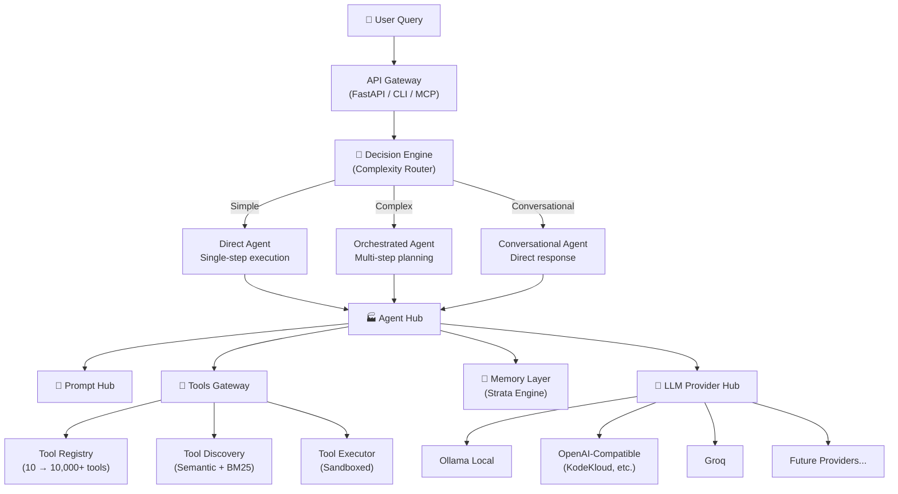

# J.A.R.V.I.S. — Architecture Master Plan

> [!IMPORTANT]
> This is the complete architecture blueprint for building a personal AI agent system modelled after Iron Man's JARVIS. Every component is **decoupled**, **runtime-composable**, and designed to scale from 5 tools today to 10,000+ tomorrow.

---

## 1. Current State Assessment

| What Exists | Status |
|---|---|
| **Strata Memory Engine** (sibling project) | ✅ Complete — 4-pillar memory (semantic, episodic, procedural, entity graph), Laya Decision Engine, MCP server, REST API, Python SDK |
| **Jarvis Workspace & Logger** | ✅ Built — workspace initialization, dual-file rotating logger |
| **Tools Gateway v1** (README references, code removed) | ⚠️ Architecture designed but source files deleted — `ToolRegistry`, `ToolDiscovery` (BM25), `ToolsGateway`, 5 initial tools |
| **LLM Provider Config** | ✅ Partial — KodeKloud OpenAI-compatible API key, LangSmith tracing configured |
| **pyproject.toml** | ✅ Dependencies for LangGraph, FastAPI, Pydantic, spaCy, Qdrant |

**What needs to be built:** The entire agent orchestration layer — decision routing, agent hub, prompt hub, tools gateway (rebuilt), provider abstraction, and the runtime wiring that connects everything.

---

## 2. High-Level Architecture



---

## 3. System Layers (Bottom-Up)

### Layer 0: Configuration & Provider Foundation

```
src/jarvis/
├── config/
│   ├── __init__.py
│   ├── settings.py          # Pydantic Settings — all env vars, validated
│   ├── provider_config.py   # Multi-provider LLM configuration
│   └── constants.py         # System-wide constants
```

**Key Design Decisions:**

- **Pydantic Settings** with `.env` auto-discovery — every config is typed and validated at startup
- **Provider Registry Pattern** — each LLM provider is a config block, not hardcoded

```python
# Example: provider_config.py
class LLMProviderConfig(BaseModel):
    name: str                           # "ollama", "kodekloud", "groq"
    kind: Literal["openai_compatible", "ollama_native"]
    base_url: str
    api_key: str = ""
    models: dict[str, ModelSpec]        # model_alias -> ModelSpec
    is_default: bool = False
    timeout_seconds: float = 120.0

class ModelSpec(BaseModel):
    model_id: str                       # actual model name on provider
    role: Literal["decision", "reasoning", "fast", "embedding"]
    max_tokens: int = 4096
    temperature: float = 0.7
```

**`.env` expansion:**
```env
# Decision Model (lightweight, fast — for routing)
DECISION_PROVIDER=ollama
DECISION_MODEL=qwen3:1.7b

# Reasoning Model (heavy — for complex tasks)  
REASONING_PROVIDER=kodekloud
REASONING_MODEL=gpt-4o

# Fast Model (for simple tasks)
FAST_PROVIDER=ollama
FAST_MODEL=qwen3:8b

# Providers
OLLAMA_BASE_URL=http://localhost:11434/v1
OLLAMA_API_KEY=ollama

KODEKLOUD_BASE_URL=https://api.ai.kodekloud.com/v1
KODEKLOUD_API_KEY=sk-xxx

GROQ_BASE_URL=https://api.groq.com/openai/v1
GROQ_API_KEY=gsk_xxx
```

---

### Layer 1: LLM Provider Hub

```
src/jarvis/
├── llm/
│   ├── __init__.py
│   ├── provider_hub.py       # Central provider registry & factory
│   ├── base_provider.py      # Abstract base class
│   ├── providers/
│   │   ├── __init__.py
│   │   ├── openai_compatible.py   # Works for KodeKloud, OpenAI, vLLM, etc.
│   │   ├── ollama.py              # Ollama-specific (native API + OpenAI compat)
│   │   └── groq.py                # Groq-specific optimizations
│   └── model_router.py       # Routes role -> provider+model at runtime
```

**Core Abstraction:**
```python
class BaseLLMProvider(ABC):
    async def complete(self, messages, tools=None, **kwargs) -> LLMResponse: ...
    async def stream(self, messages, tools=None, **kwargs) -> AsyncIterator[LLMChunk]: ...
    async def embed(self, texts: list[str]) -> list[list[float]]: ...

class ProviderHub:
    """Registry of all configured providers. Resolves role-based routing."""
    def get_provider(self, role: ModelRole) -> BaseLLMProvider: ...
    def get_decision_model(self) -> BaseLLMProvider: ...
    def get_reasoning_model(self) -> BaseLLMProvider: ...
```

---

### Layer 2: Decision Engine (Complexity Router)

```
src/jarvis/
├── decision/
│   ├── __init__.py
│   ├── complexity_analyzer.py   # Classifies query complexity
│   ├── intent_classifier.py     # Detects intent category
│   ├── task_router.py           # Routes to appropriate agent template
│   └── schemas.py               # TaskClassification, RoutingDecision
```

This is the **brain's first touch** — every user query hits the Decision Engine before anything else.

**Classification Output:**
```python
class TaskClassification(BaseModel):
    complexity: Literal["simple", "moderate", "complex"]
    intent: str                    # "web_search", "file_processing", "code_generation", "conversation", "research", etc.
    requires_planning: bool        # Does this need multi-step decomposition?
    requires_memory: bool          # Should we recall past context?
    suggested_agent: str           # Agent template ID from the Agent Hub
    suggested_tools: list[str]     # Pre-filtered tool categories
    confidence: float
    reasoning: str                 # Why this classification
```

**How it works:**

1. **Fast-path heuristic** (zero-LLM): Pattern matching, keyword analysis, query length — handles obvious cases like greetings, simple lookups
2. **Decision model** (lightweight LLM): For ambiguous queries, uses the configured decision model (e.g., `qwen3:1.7b` on Ollama) with a structured output prompt
3. **Memory-augmented**: Optionally recalls past similar tasks from Strata's episodic memory to improve routing accuracy

---

### Layer 3: Prompt Hub

```
src/jarvis/
├── prompts/
│   ├── __init__.py
│   ├── prompt_hub.py            # Central registry & template engine
│   ├── prompt_loader.py         # Loads from YAML/Markdown files
│   ├── prompt_composer.py       # Runtime composition with context injection
│   ├── templates/               # Static prompt template library
│   │   ├── system/
│   │   │   ├── jarvis_core.yaml          # Base JARVIS personality & rules
│   │   │   ├── decision_router.yaml      # Decision engine classification prompt
│   │   │   └── memory_instructions.yaml  # How to use Strata memory tools
│   │   ├── agents/
│   │   │   ├── reflex_agent.yaml         # Simple reactive agent
│   │   │   ├── research_agent.yaml       # Web research + synthesis
│   │   │   ├── code_agent.yaml           # Code generation & analysis
│   │   │   ├── file_processor.yaml       # Document processing agent
│   │   │   └── planning_agent.yaml       # Complex multi-step planner
│   │   └── tools/
│   │       ├── tool_selection.yaml       # How to select tools
│   │       └── tool_execution.yaml       # How to call and handle tool results
│   └── schemas.py
```

**Key Design: Runtime Composition**

Prompts are **never monolithic**. At runtime, the Prompt Hub composes the final prompt by layering:

```
┌─────────────────────────────────────┐
│  1. Core System Identity (JARVIS)   │  ← Always included
├─────────────────────────────────────┤
│  2. Agent-Specific Instructions     │  ← From Agent Hub template
├─────────────────────────────────────┤
│  3. Memory Context Block            │  ← Injected from Strata recall
├─────────────────────────────────────┤
│  4. Available Tools Schema          │  ← From Tools Gateway discovery
├─────────────────────────────────────┤
│  5. Task-Specific Context           │  ← User query + any file content
└─────────────────────────────────────┘
```

```python
class PromptHub:
    def compose(
        self,
        agent_template: str,
        memory_context: str | None,
        available_tools: list[ToolDefinition],
        task_context: dict,
    ) -> list[Message]:
        """Compose a complete prompt by layering templates + runtime context."""
```

---

### Layer 4: Tools Gateway (Uber-Scale Architecture)

```
src/jarvis/
├── tools/
│   ├── __init__.py
│   ├── schemas.py               # ToolDefinition, ToolResult, ToolParameter
│   ├── tool_registry.py         # In-memory tool store + metadata index
│   ├── tool_discovery.py        # Semantic + BM25 hybrid search over tools
│   ├── tool_gateway.py          # Central execution engine
│   ├── tool_validator.py        # JSON Schema argument validation
│   ├── tool_sandbox.py          # Execution isolation & timeout management
│   ├── decorators.py            # @jarvis_tool decorator for easy registration
│   ├── implementations/         # Actual tool implementations
│   │   ├── __init__.py
│   │   ├── filesystem/          # File ops tools
│   │   │   ├── list_files.py
│   │   │   ├── read_file.py
│   │   │   ├── write_file.py
│   │   │   └── search_files.py
│   │   ├── shell/               # Command execution
│   │   │   └── run_command.py
│   │   ├── web/                 # Web interaction tools
│   │   │   ├── web_search.py
│   │   │   └── web_scrape.py
│   │   └── memory/              # Strata memory bridge tools
│   │       ├── memory_recall.py
│   │       ├── memory_ingest.py
│   │       ├── memory_store.py
│   │       └── memory_feedback.py
│   └── gateway_tools/           # Meta-tools exposed to agents
│       ├── search_tools.py      # "Find me a tool that can..."
│       ├── list_tools.py        # "What tools are available for..."
│       └── execute_tool.py      # "Execute tool X with args Y"
```

**The Uber Pattern — How 10,000+ Tools Scale:**

Every agent does NOT see all 10,000 tools. Instead, agents get **exactly 3 meta-tools** (gateway tools):

| Gateway Tool | Purpose |
|---|---|
| `search_tools(query, category?)` | Semantic + BM25 search across the entire registry. Returns top-K `ToolDefinition` schemas. |
| `list_tools(category?)` | List tools in a category (for browsing). |
| `execute_tool(tool_id, arguments)` | Validate args against schema → sandbox → execute → return `ToolResult`. |

```python
# What the agent sees (only 3 tools):
tools = [
    search_tools,    # "Find tools for web scraping"  → returns ToolDefinitions
    list_tools,      # "List all file tools"           → returns ToolDefinitions
    execute_tool,    # "Run read_file with {path: x}"  → returns ToolResult
]

# What happens internally:
# 1. Agent calls search_tools("send email") 
# 2. ToolDiscovery ranks 10,000 tools via BM25 + embedding similarity
# 3. Returns top-3 ToolDefinitions with full JSON schemas
# 4. Agent reads schemas, picks one, calls execute_tool(tool_id, {args})
# 5. ToolGateway validates args, sandboxes execution, returns ToolResult
```

**Tool Registration (decorator-based):**
```python
@jarvis_tool(
    tool_id="web_search",
    name="Web Search",
    description="Search the web using DuckDuckGo/Google and return summarized results",
    category="web",
    parameters={
        "query": {"type": "string", "description": "Search query", "required": True},
        "max_results": {"type": "integer", "description": "Max results", "default": 5},
    },
)
async def web_search(query: str, max_results: int = 5) -> dict:
    ...
```

---

### Layer 5: Memory Layer (Strata Integration)

```
src/jarvis/
├── memory/
│   ├── __init__.py
│   ├── memory_bridge.py        # Async bridge to Strata SDK (in-process)
│   ├── memory_manager.py       # High-level memory operations for agents
│   ├── context_builder.py      # Builds memory context blocks for prompts
│   └── schemas.py              # MemoryContext, RecallResult
```

**Integration Strategy:** Direct Python SDK (in-process) to Strata — no network hop, <15ms recall.

```python
class MemoryManager:
    """High-level memory interface for JARVIS agents."""
    
    async def recall_for_task(self, query: str, task_type: str) -> MemoryContext:
        """Smart recall: adjusts pillars and token budget based on task type."""
        
    async def learn(self, raw_text: str) -> None:
        """Ingest new information through Strata's Laya decision pipeline."""
        
    async def report_outcome(self, task_name: str, success: bool, error: str = "") -> None:
        """Feed back task results for procedural self-healing."""
        
    async def build_context_block(self, query: str) -> str:
        """Build the <strata_memory_context> XML block for prompt injection."""
```

---

### Layer 6: Agent Hub (Runtime-Composable Agents)

```
src/jarvis/
├── agents/
│   ├── __init__.py
│   ├── agent_hub.py             # Central agent registry & factory
│   ├── base_agent.py            # Abstract base agent interface
│   ├── agent_builder.py         # Runtime agent composer
│   ├── agent_context.py         # Shared execution context (memory, tools, state)
│   ├── templates/               # Pre-built agent archetypes
│   │   ├── __init__.py
│   │   ├── reflex_agent.py      # Simple stimulus-response (one LLM call)
│   │   ├── conversational.py    # Multi-turn chat with memory
│   │   ├── research_agent.py    # Web search + synthesis + citation
│   │   ├── planning_agent.py    # ReAct/Plan-and-Execute for complex tasks
│   │   ├── code_agent.py        # Code gen, review, debugging
│   │   └── file_processor.py    # Document parsing, analysis, transformation
│   ├── execution/
│   │   ├── __init__.py
│   │   ├── react_executor.py    # ReAct loop: Thought → Action → Observation
│   │   ├── plan_executor.py     # Plan-and-Execute: Plan → Steps → Execute each
│   │   └── simple_executor.py   # Single-shot: prompt → response
│   └── schemas.py               # AgentTemplate, AgentConfig, ExecutionResult
```

**Runtime Composition — How it Connects:**

```python
class AgentBuilder:
    """Composes a fully-wired agent at runtime from decoupled components."""
    
    def build(self, template_id: str, task: TaskClassification) -> BaseAgent:
        # 1. Load agent template from Agent Hub
        template = self.agent_hub.get_template(template_id)
        
        # 2. Get the right LLM provider for this task's complexity
        llm = self.provider_hub.get_provider(task.complexity_to_role())
        
        # 3. Discover relevant tools via Tools Gateway
        tools = self.tool_gateway.discover(task.suggested_tools)
        
        # 4. Recall relevant memory context
        memory_ctx = await self.memory_manager.recall_for_task(task.query, task.intent)
        
        # 5. Compose the prompt via Prompt Hub
        prompt = self.prompt_hub.compose(
            agent_template=template.prompt_template,
            memory_context=memory_ctx,
            available_tools=tools,
            task_context=task.context,
        )
        
        # 6. Select the execution strategy
        executor = self._get_executor(template.execution_mode)
        
        # 7. Wire and return a fully configured agent
        return template.agent_class(
            llm=llm,
            prompt=prompt,
            tools=tools,
            executor=executor,
            memory=self.memory_manager,
        )
```

**Agent Template Registry (YAML-driven):**
```yaml
# agents/templates/research_agent.yaml
id: research_agent
name: "Research Agent"
description: "Web research, synthesis, and citation"
execution_mode: react          # react | plan_execute | simple
llm_role: reasoning            # decision | fast | reasoning
prompt_template: research_agent
tool_categories: ["web", "memory"]
max_iterations: 10
memory_config:
  recall_before_start: true
  pillars: ["semantic", "episodic"]
  token_budget: 1500
  learn_after_completion: true
```

---

### Layer 7: Orchestration Core

```
src/jarvis/
├── core/
│   ├── __init__.py
│   ├── jarvis.py               # The main JARVIS orchestrator
│   ├── session.py              # Conversation session management
│   ├── pipeline.py             # Query → Decision → Agent → Response pipeline
│   └── schemas.py              # JarvisRequest, JarvisResponse, Session
```

```python
class Jarvis:
    """The main JARVIS orchestrator — the Iron Man experience."""
    
    async def process(self, request: JarvisRequest) -> JarvisResponse:
        # 1. Recall memory context for this query
        memory_ctx = await self.memory.recall_for_task(request.query, "general")
        
        # 2. Decision Engine: classify complexity & intent
        classification = await self.decision_engine.classify(
            query=request.query,
            memory_context=memory_ctx,
            session=request.session,
        )
        
        # 3. Agent Hub: build the right agent at runtime
        agent = await self.agent_builder.build(
            template_id=classification.suggested_agent,
            task=classification,
        )
        
        # 4. Execute the agent
        result = await agent.execute(request.query)
        
        # 5. Learn from the interaction
        await self.memory.learn(f"Task: {request.query}\nResult: {result.summary}")
        await self.memory.report_outcome(
            task_name=classification.intent,
            success=result.success,
            error=result.error or "",
        )
        
        # 6. Return structured response
        return JarvisResponse(
            answer=result.answer,
            sources=result.sources,
            tools_used=result.tools_used,
            agent_used=classification.suggested_agent,
            complexity=classification.complexity,
        )
```

---

## 4. Interface Layer (Multiple Entry Points)

```
src/jarvis/
├── interfaces/
│   ├── __init__.py
│   ├── cli.py                  # Terminal REPL interface
│   ├── api.py                  # FastAPI REST server
│   └── mcp_server.py           # MCP server for IDE integration
```

All three interfaces use the same `Jarvis.process()` entry point — the orchestration is interface-agnostic.

---

## 5. Complete Directory Structure

```
src/jarvis/
├── __init__.py
├── config/
│   ├── __init__.py
│   ├── settings.py
│   ├── provider_config.py
│   └── constants.py
├── llm/
│   ├── __init__.py
│   ├── provider_hub.py
│   ├── base_provider.py
│   ├── providers/
│   │   ├── __init__.py
│   │   ├── openai_compatible.py
│   │   ├── ollama.py
│   │   └── groq.py
│   └── model_router.py
├── decision/
│   ├── __init__.py
│   ├── complexity_analyzer.py
│   ├── intent_classifier.py
│   ├── task_router.py
│   └── schemas.py
├── prompts/
│   ├── __init__.py
│   ├── prompt_hub.py
│   ├── prompt_loader.py
│   ├── prompt_composer.py
│   ├── templates/
│   │   ├── system/
│   │   ├── agents/
│   │   └── tools/
│   └── schemas.py
├── tools/
│   ├── __init__.py
│   ├── schemas.py
│   ├── tool_registry.py
│   ├── tool_discovery.py
│   ├── tool_gateway.py
│   ├── tool_validator.py
│   ├── tool_sandbox.py
│   ├── decorators.py
│   ├── implementations/
│   │   ├── filesystem/
│   │   ├── shell/
│   │   ├── web/
│   │   └── memory/
│   └── gateway_tools/
│       ├── search_tools.py
│       ├── list_tools.py
│       └── execute_tool.py
├── memory/
│   ├── __init__.py
│   ├── memory_bridge.py
│   ├── memory_manager.py
│   ├── context_builder.py
│   └── schemas.py
├── agents/
│   ├── __init__.py
│   ├── agent_hub.py
│   ├── base_agent.py
│   ├── agent_builder.py
│   ├── agent_context.py
│   ├── templates/
│   │   ├── reflex_agent.py
│   │   ├── conversational.py
│   │   ├── research_agent.py
│   │   ├── planning_agent.py
│   │   ├── code_agent.py
│   │   └── file_processor.py
│   ├── execution/
│   │   ├── react_executor.py
│   │   ├── plan_executor.py
│   │   └── simple_executor.py
│   └── schemas.py
├── core/
│   ├── __init__.py
│   ├── jarvis.py
│   ├── session.py
│   ├── pipeline.py
│   └── schemas.py
├── interfaces/
│   ├── __init__.py
│   ├── cli.py
│   ├── api.py
│   └── mcp_server.py
├── logger.py
└── workspace.py
```

---

## 6. Implementation Phases

### Phase 1: Foundation (Config + LLM Providers + Decision Engine)
**Goal:** You can send a query, it classifies complexity, and routes to the right model.

| Module | What's Built |
|---|---|
| `config/settings.py` | Pydantic Settings with all env vars |
| `config/provider_config.py` | Multi-provider config schema |
| `llm/base_provider.py` | Abstract provider interface |
| `llm/providers/openai_compatible.py` | KodeKloud, OpenAI, any OpenAI-compat endpoint |
| `llm/providers/ollama.py` | Ollama local models |
| `llm/provider_hub.py` | Provider registry + role-based routing |
| `decision/complexity_analyzer.py` | Heuristic + LLM complexity classification |
| `decision/task_router.py` | Route classification → agent template ID |

**Deliverable:** `jarvis.classify("Search the web for latest Python 3.14 features")` → `TaskClassification(complexity="simple", intent="web_search", suggested_agent="reflex_agent")`

---

### Phase 2: Tools Gateway (Registry + Discovery + Gateway)
**Goal:** Tools can be registered, discovered via natural language, and executed safely.

| Module | What's Built |
|---|---|
| `tools/schemas.py` | `ToolDefinition`, `ToolResult`, `ToolParameter` |
| `tools/decorators.py` | `@jarvis_tool` decorator |
| `tools/tool_registry.py` | In-memory store, category index, dedup |
| `tools/tool_discovery.py` | BM25 + optional embedding hybrid search |
| `tools/tool_validator.py` | JSON Schema argument validation |
| `tools/tool_gateway.py` | Central execution with sandbox |
| `tools/gateway_tools/` | The 3 meta-tools agents see |
| `tools/implementations/filesystem/` | 4 file tools (list, read, write, search) |
| `tools/implementations/shell/` | run_command with allowlist |

**Deliverable:** `gateway.discover("find files in project")` → `[ToolDefinition(list_files), ToolDefinition(search_files)]`

---

### Phase 3: Memory Integration + Prompt Hub
**Goal:** Strata memory is wired in, prompts compose dynamically with memory context.

| Module | What's Built |
|---|---|
| `memory/memory_bridge.py` | Async bridge to Strata Python SDK |
| `memory/memory_manager.py` | High-level recall/learn/feedback |
| `memory/context_builder.py` | XML context block builder |
| `prompts/prompt_hub.py` | Template registry |
| `prompts/prompt_composer.py` | Runtime layered composition |
| `prompts/templates/` | All YAML prompt templates |
| `tools/implementations/memory/` | Memory bridge tools for agents |

**Deliverable:** Before answering, JARVIS recalls relevant past memories and injects them into the agent's system prompt.

---

### Phase 4: Agent Hub + Execution Strategies
**Goal:** Multiple agent templates run with different execution strategies, composed at runtime.

| Module | What's Built |
|---|---|
| `agents/base_agent.py` | Abstract agent interface |
| `agents/agent_hub.py` | Template registry |
| `agents/agent_builder.py` | Runtime agent composer |
| `agents/templates/` | All agent templates (reflex, research, planning, code, etc.) |
| `agents/execution/` | ReAct, Plan-and-Execute, Simple executors |

**Deliverable:** `builder.build("research_agent", task)` → A fully wired agent with the right LLM, tools, memory, and prompt.

---

### Phase 5: Orchestrator + Interfaces
**Goal:** End-to-end working JARVIS with CLI, API, and MCP interfaces.

| Module | What's Built |
|---|---|
| `core/jarvis.py` | Main orchestrator |
| `core/session.py` | Conversation state management |
| `core/pipeline.py` | Full query→response pipeline |
| `interfaces/cli.py` | Terminal REPL |
| `interfaces/api.py` | FastAPI REST server |

**Deliverable:** Full JARVIS experience — ask anything, get intelligent routing, memory-augmented responses.

---

## 7. Key Architectural Principles

| Principle | How It's Applied |
|---|---|
| **Fully Decoupled** | Every hub (Agent, Prompt, Tools, Memory, LLM) is an independent module with its own schemas. No hub imports another hub directly — they connect through the Orchestrator. |
| **Runtime Composable** | Nothing is hardcoded at import time. Agent + Prompt + Tools + Memory + LLM are wired together at request time based on the Decision Engine output. |
| **Uber-Scale Tools** | Agents don't see 10,000 tools. They see 3 gateway tools. The gateway handles discovery, validation, and execution internally. |
| **Provider Agnostic** | Switch from Ollama to KodeKloud to Groq by changing an env var. Add new providers by implementing one class. |
| **Memory-First** | Every interaction starts with memory recall and ends with memory ingestion. Past mistakes heal future runbooks automatically. |
| **Configuration-Driven** | Agent templates, prompts, tool registrations — all driven by YAML/config. Change behavior without changing code. |

---

## 8. Technology Stack

| Component | Technology |
|---|---|
| Language | Python 3.12+ |
| Package Manager | `uv` |
| Framework | LangGraph (agent execution graphs) |
| API | FastAPI + Uvicorn |
| LLM Client | `httpx` / `openai` SDK (OpenAI-compatible) |
| Memory | Strata Engine (in-process Python SDK) |
| Embeddings | Ollama (`nomic-embed-text`) / configurable |
| Tool Discovery | `rank-bm25` + optional embedding similarity |
| Schema Validation | Pydantic v2 |
| Tracing | LangSmith |
| Testing | pytest + async fixtures |
| NLP (optional) | spaCy (for entity extraction in decision engine) |

---

## 9. Open Design Questions for Discussion

| # | Question | Options |
|---|---|---|
| 1 | **LangGraph vs. Custom?** | Use LangGraph for agent execution graphs (already in deps) vs. build custom ReAct/Plan-Execute loops? LangGraph gives us checkpointing, streaming, and state management for free. |
| 2 | **Strata as subprocess or in-process?** | In-process SDK call (<15ms) vs. MCP/REST call (network latency). Recommendation: **in-process for Jarvis, MCP for external agents.** |
| 3 | **Tool discovery: BM25 only or hybrid?** | BM25 is fast and works for hundreds of tools. At 1000+ tools, add embedding-based semantic search. Start with BM25, add embeddings later. |
| 4 | **Session persistence?** | SQLite local file vs. Neon PostgreSQL (same Strata DB)? For a personal agent, SQLite is simpler. |
| 5 | **Agent templates: Python classes or YAML-only?** | Each template needs both: a YAML config (metadata, prompt template, tool categories) + a Python class (execution logic). The YAML drives the wiring; the Python defines the behavior. |
| 6 | **Which initial agent templates to build?** | Suggested Phase 4 set: Reflex (simple), Conversational (chat), Research (web), Planning (complex), Code (dev tasks). Add more later as needed. |

