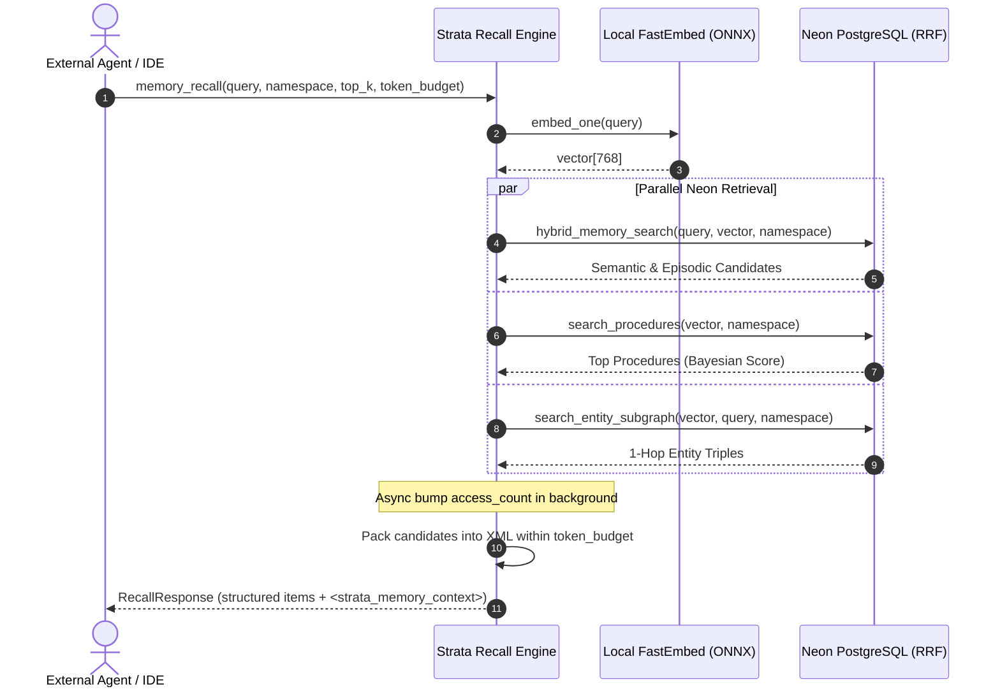
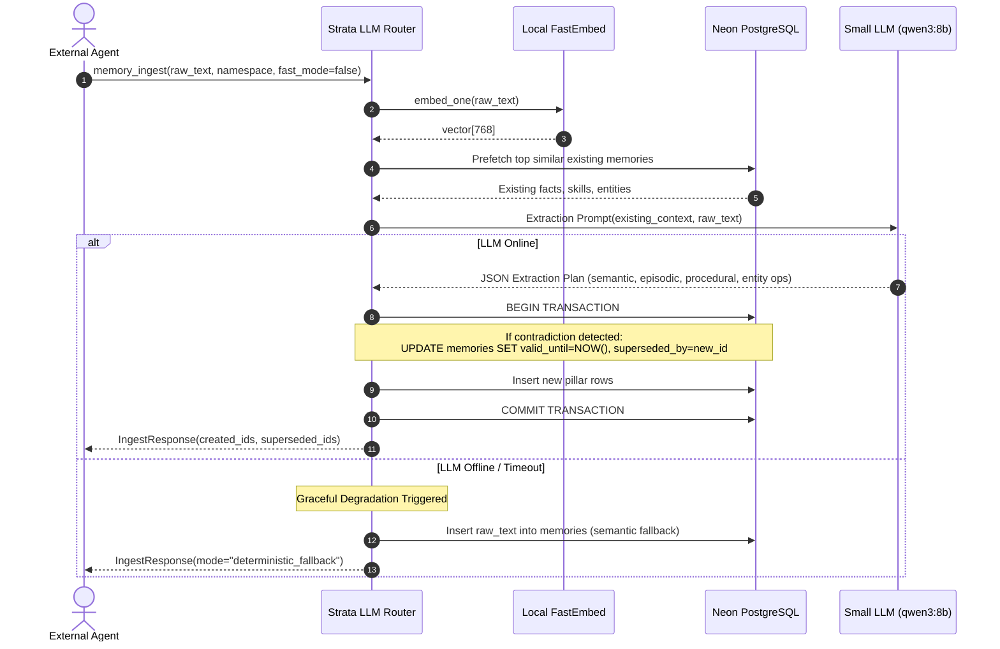
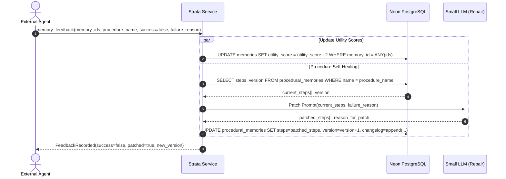

# Strata Memory Engine: Complete Architecture, Components & Execution Flows

This document provides an exhaustive technical analysis of the **Strata Cognitive Memory Engine** architecture, its internal subsystems, data contracts, and detailed sequence flows.

---

## 1. Executive Architectural Overview

Strata is modeled on geological strata: **layered records of history where foundational facts remain anchored beneath recent experiences, adaptable procedures evolve over time, and inter-connected entities form an immutable web of context.**

To avoid the twin failure modes of classical agent memory systems (high recall latency and unbounded context bloat), Strata enforces a strict **Dual-Path Architecture**:

```
                                  +-------------------------------------------------------------+
                                  |                 EXTERNAL AGENT / HARNESS                    |
                                  |     (LangGraph, CrewAI, AutoGen, Claude Desktop, Cursor)    |
                                  +------------------------------+------------------------------+
                                                                 |
                                       +-------------------------+-------------------------+
                                       |                                                   |
                             READ PATH (<15ms, Zero-LLM)                         WRITE PATH (Autonomous)
                             `memory_recall`                                     `memory_ingest`, `memory_edit`
                                       |                                                   |
                                       v                                                   v
                        +------------------------------+                    +------------------------------+
                        |  Local FastEmbed ONNX Model  |                    | Memory-Side Small LLM Router |
                        | (BAAI/bge-base-en-v1.5: 768) |                    |  (`qwen3:8b` via Ollama/API) |
                        +--------------+---------------+                    +--------------+---------------+
                                       |                                                   |
                                       | Vector Embedding                                  | Prefetches Context &
                                       |                                                   | Splits into 4 Pillars
                                       v                                                   v
+-------------------------------------------------------------------------------------------------------------------------+
|                                             NEON SERVERLESS POSTGRESQL 16                                               |
|                               (PgBouncer `-pooler` Transaction Mode + `statement_cache_size=0`)                         |
|                                                                                                                         |
|   +--------------------------------+   +--------------------------------+   +--------------------------------+          |
|   |        `memories` TABLE        |   |  `procedural_memories` TABLE   |   |     `entity_nodes` & `edges`   |          |
|   | • Semantic: Bi-temporal Facts  |   | • Mutable Versioned Runbooks   |   | • Bi-temporal Property Graph   |          |
|   | • Episodic: Execution Traces   |   | • Bayesian Skill Ranking       |   | • 1-Hop Subgraph Traversal     |          |
|   | • HNSW (m=16, ef=64) + GIN FTS |   | • Auto-Patched on Failure      |   | • Conflicting Edge Expiration  |          |
|   +--------------------------------+   +--------------------------------+   +--------------------------------+          |
|                                                    ^                                                                    |
|                                                    |                                                                    |
|                                  `hybrid_memory_search()` SQL Function                                                  |
|                               (Reciprocal Rank Fusion + Utility Score Boost)                                            |
+----------------------------------------------------+--------------------------------------------------------------------+
                                                     |
                                                     v
                                      +------------------------------+
                                      |    Deterministic XML Pack    |
                                      |   (Truncated to token_budget)|
                                      +--------------+---------------+
                                                     |
                                                     v
                                        Clean `<strata_memory_context>`
```

---

## 2. The 4 Cognitive Memory Pillars

### 2.1 The Semantic Pillar (`type = 'semantic'`)
* **Purpose:** Stores atomic facts, configurations, domain truths, and user preferences.
* **Bi-Temporal Validity:** Every record has `valid_from TIMESTAMPTZ` and `valid_until TIMESTAMPTZ` (where `valid_until IS NULL` indicates the fact is active).
* **Contradiction Superseding:** When a new fact is learned that contradicts an existing fact (either explicitly targeted or automatically detected via cosine similarity `> 0.94` in the same namespace), Strata atomically sets:
  ```sql
  UPDATE memories 
  SET valid_until = NOW(), superseded_by = $new_memory_id 
  WHERE memory_id = $old_memory_id;
  ```
  This preserves historical lineage without polluting future recall queries.

### 2.2 The Episodic Pillar (`type = 'episodic'`)
* **Purpose:** Immutable append-only log of agent execution traces, situations encountered, tools invoked, and final outcomes.
* **Payload Structure (`JSONB`):**
  ```json
  {
    "situation": "Context or problem triggering the run",
    "action_taken": "Tools and steps executed by the agent",
    "outcome": "Observed result or error trace",
    "success": true
  }
  ```
* **Utility Scoring Loop:** When downstream tasks succeed or fail, `memory_feedback` adjusts the `utility_score` of memories used (`+1` for success, `-2` for failure). The RRF ranking engine uses this score to boost proven memories and demote misleading memories.

### 2.3 The Procedural Pillar (`procedural_memories` Table)
* **Purpose:** Reusable, versioned workflows, skills, runbooks, and troubleshooting procedures.
* **Mutable Schema:**
  - `name`: Unique identifier per namespace (`UNIQUE(namespace, name)`).
  - `version`: Integer automatically incremented upon every modification.
  - `steps`: `JSONB` list of clear, executable instructions.
  - `changelog`: `JSONB` array of past modifications with timestamps and reasons.
  - `success_count` & `fail_count`: Track real-world execution reliability.
* **Bayesian Composite Ranking Formula:**
  $$\text{Score} = 0.75 \times (1 - \text{CosineDistance}) + 0.25 \times \left(\frac{\text{success\_count} + 1}{\text{success\_count} + \text{fail\_count} + 2}\right)$$
  - Employs **Laplace smoothing (add-1 smoothing)**: An untested skill with 0 runs starts with an objective baseline of $1 / 2 = 0.50$ (50% probability).
* **Self-Healing Runbooks:** If an agent executes a procedure and reports failure with an error trace via `memory_feedback`, Strata's Small LLM analyzes the error, patches the `steps[]`, increments `version`, and logs the repair reason in `changelog`.

### 2.4 The Entity Graph Pillar (`entity_nodes` & `entity_edges`)
* **Purpose:** Bi-temporal property graph connecting entities (people, services, repositories, servers, concepts).
* **Triples:** `(Source Node) -[Relation Type]-> (Target Node)` with `fact_summary` and JSON properties.
* **Conflicting Relation Expiration:** When an entity changes states (e.g. `Velora` changes its `RUNS_ON` relation from `AWS` to `GCP`), setting `invalidate_conflicting_relations = true` marks prior edges with the same `(namespace, source, relation)` as `valid_until = NOW()`.
* **1-Hop Traversal:** During recall, seed nodes matching the query are joined across active edges to retrieve connected triples.

---

## 3. Subsystem & Component Breakdown

### 3.1 Client Ingress Adapters
* **FastMCP Server (`src/strata/mcp_server.py`):**
  - Uses `FastMCP("Strata Memory Engine")`.
  - Exposes all 6 tools to Claude Desktop, Cursor, Zed, and Windsurf.
  - Supports `--transport stdio` (with all logs redirected to `sys.stderr` to prevent JSON-RPC stream corruption) and `--transport sse` for distributed networks.
* **FastAPI Server (`src/strata/rest_api.py`):**
  - Exposes REST endpoints (`/v1/memory/*`) with async lifespan management (`lifespan`) ensuring clean database connection pooling.
  - Generates interactive OpenAPI Swagger UI at `/docs`.
* **Service Controller (`src/strata/service.py`):**
  - Unified business logic hub shared by both MCP and REST entrypoints. Eliminates duplicate code and enforces consistency.

### 3.2 Local Embedding Engine (`src/strata/embedder.py`)
* **Engine:** `FastEmbed` (ONNX Runtime, CPU-optimized, zero PyTorch overhead).
* **Model:** `BAAI/bge-base-en-v1.5` generating dense **768-dimensional** vector embeddings.
* **Safe Serialization:** Formats vector floats into text literals (`[0.0123456,...]`) passed to Neon via `$1::vector(768)`. This avoids asyncpg custom C-extension decoding errors.

### 3.3 Neon Database Layer (`src/strata/db.py`)
* **PgBouncer `-pooler` Compatibility:** Neon pooled connections operate in transaction mode. Strata explicitly passes `statement_cache_size=0` to prevent prepared statement conflicts.
* **Dual-Connection Management:**
  - `DATABASE_URL`: Pooled connection with SSL for runtime queries (`min_size=1, max_size=10`).
  - `DIRECT_DATABASE_URL`: Direct unpooled connection used exclusively for DDL migrations (`sql/001_init_schema.sql`).
* **Scale-to-Zero Handling:** Neon serverless compute suspend/resume cycles are protected by `max_inactive_connection_lifetime=300.0`.
* **DSN Sanitization:** `normalize_dsn()` automatically strips unsupported query parameters like `channel_binding` while converting `sslmode=require` to asyncpg's expected format.

### 3.4 Memory-Side Small LLM Router (`src/strata/llm_processor/router.py`)
* **Model:** `qwen3:8b` (or any local/remote model via Ollama, LM Studio, or OpenAI-compatible endpoint).
* **Extraction Workflow:**
  1. Computes local query vector.
  2. Prefetches top-5 semantic facts, top-3 procedures, and top-5 entities from Neon.
  3. Formulates structured prompt with `response_format={"type": "json_object"}`.
  4. Decomposes raw text into structured operations across the 4 pillars.
* **Graceful Degradation:** If the Small LLM times out or is offline, Strata catches the exception and immediately falls back to deterministic storage into `memories`, ensuring the calling agent never crashes.

### 3.5 Deterministic Recall & Packing Engine (`src/strata/recall.py`)
* **Concurrent Querying:** Dispatches `hybrid_memory_search` (Semantic + Episodic), `search_procedures` (Procedural), and `search_entity_subgraph` (Entity) concurrently via `asyncio.gather`.
* **Asynchronous Access Counter:** Launches an asynchronous background task to increment `access_count` on all returned memory UUIDs without adding query latency.
* **Token Budget Packing:** Calculates string length to token ratio (`chars // 4`) and packs items section by section. If budget is exceeded, it cleanly closes all XML tags, preserving XML validity.

---

## 4. End-to-End Sequence Flows

### Flow 1: Deterministic Hybrid Recall (`memory_recall`)


---

### Flow 2: Autonomous Ingestion & Contradiction Superseding (`memory_ingest`)


---

### Flow 3: Reinforcement Learning & Runbook Self-Healing (`memory_feedback`)


---

## 5. Database Schema & Indexing Architecture

### 5.1 Tables & Schema Constraints

```sql
-- Core Fact & Event Store
CREATE TABLE memories (
    memory_id UUID PRIMARY KEY DEFAULT gen_random_uuid(),
    namespace TEXT NOT NULL DEFAULT 'default',
    type TEXT NOT NULL CHECK (type IN ('semantic', 'episodic')),
    summary TEXT NOT NULL,
    payload JSONB NOT NULL DEFAULT '{}'::jsonb,
    tags TEXT[] NOT NULL DEFAULT '{}',
    embedding VECTOR(768) NOT NULL,
    confidence FLOAT NOT NULL DEFAULT 1.0,
    utility_score INT NOT NULL DEFAULT 0,
    access_count INT NOT NULL DEFAULT 0,
    source_id TEXT,
    superseded_by UUID REFERENCES memories(memory_id) ON DELETE SET NULL,
    valid_from TIMESTAMPTZ NOT NULL DEFAULT NOW(),
    valid_until TIMESTAMPTZ DEFAULT NULL,
    created_at TIMESTAMPTZ NOT NULL DEFAULT NOW()
);

-- Versioned Skill & Workflow Store
CREATE TABLE procedural_memories (
    procedure_id UUID PRIMARY KEY DEFAULT gen_random_uuid(),
    namespace TEXT NOT NULL DEFAULT 'default',
    name TEXT NOT NULL,
    description TEXT NOT NULL,
    trigger_condition TEXT NOT NULL,
    trigger_embedding VECTOR(768) NOT NULL,
    steps JSONB NOT NULL DEFAULT '[]'::jsonb,
    prerequisites JSONB NOT NULL DEFAULT '{}'::jsonb,
    version INT NOT NULL DEFAULT 1,
    changelog JSONB NOT NULL DEFAULT '[]'::jsonb,
    success_count INT NOT NULL DEFAULT 0,
    fail_count INT NOT NULL DEFAULT 0,
    is_active BOOLEAN NOT NULL DEFAULT TRUE,
    updated_at TIMESTAMPTZ NOT NULL DEFAULT NOW(),
    UNIQUE(namespace, name)
);

-- Entity Nodes (Knowledge Graph)
CREATE TABLE entity_nodes (
    entity_id UUID PRIMARY KEY DEFAULT gen_random_uuid(),
    namespace TEXT NOT NULL DEFAULT 'default',
    name TEXT NOT NULL,
    entity_type TEXT NOT NULL,
    summary TEXT NOT NULL,
    attributes JSONB NOT NULL DEFAULT '{}'::jsonb,
    embedding VECTOR(768) NOT NULL,
    updated_at TIMESTAMPTZ NOT NULL DEFAULT NOW(),
    UNIQUE(namespace, name, entity_type)
);

-- Entity Edges (Bi-temporal Relationships)
CREATE TABLE entity_edges (
    edge_id UUID PRIMARY KEY DEFAULT gen_random_uuid(),
    namespace TEXT NOT NULL DEFAULT 'default',
    source_entity_id UUID NOT NULL REFERENCES entity_nodes(entity_id) ON DELETE CASCADE,
    relation_type TEXT NOT NULL,
    target_entity_id UUID NOT NULL REFERENCES entity_nodes(entity_id) ON DELETE CASCADE,
    fact_summary TEXT NOT NULL,
    properties JSONB NOT NULL DEFAULT '{}'::jsonb,
    valid_from TIMESTAMPTZ NOT NULL DEFAULT NOW(),
    valid_until TIMESTAMPTZ DEFAULT NULL
);
```

### 5.2 Performance Indexing Strategy

1. **HNSW Indexes (Vector Cosine Operations):**
   - Built on `memories.embedding`, `procedural_memories.trigger_embedding`, and `entity_nodes.embedding`.
   - Tuned with `WITH (m = 16, ef_construction = 64)` for sub-millisecond approximate nearest neighbor (ANN) lookups.
2. **GIN Index (Full-Text Search):**
   - Built on `to_tsvector('english', summary)` on `memories` table to empower hybrid lexical BM25 matching.
3. **Partial B-Tree Indexes:**
   - `idx_memories_ns_type_active`: Built on `(namespace, type) WHERE valid_until IS NULL` to ensure active memories are filtered in constant time without scanning superseded rows.
   - `idx_entity_edges_active`: Built on `(namespace, source_entity_id, target_entity_id) WHERE valid_until IS NULL`.

---

## 6. Fault Tolerance & Graceful Degradation Matrix

| Scenario / Failure | Impact | Strata Handling Mechanism |
|---|---|---|
| **Ollama / Local LLM Offline** | Write Path `memory_ingest` | Automatically catches connection error and performs a zero-LLM deterministic insert into `memories` table (`mode: "deterministic_fallback"`). Calling agent never crashes. |
| **Neon Compute Sleeping (Scale-to-Zero)** | Cold-start query | Neon wakes compute automatically within 500ms–1.5s. `asyncpg` pool handles connection retry with `command_timeout=30.0` and `max_inactive_connection_lifetime=300.0`. |
| **Empty or Whitespace Search Query** | Full-Text Search in `hybrid_memory_search` | SQL function verifies `websearch_to_tsquery` parsing safely; if empty or stop-words, bypasses BM25 and falls back seamlessly to 100% vector cosine search. |
| **High Concurrency on Neon** | Connection Limits | PgBouncer `-pooler` endpoint multiplexes hundreds of concurrent client connections over 10 direct server connections with `statement_cache_size=0`. |
| **Very Small Token Budget** | XML Context Packing | Token budgeter truncates candidates item by item and appends closing XML tags, guaranteeing valid XML syntax. |
