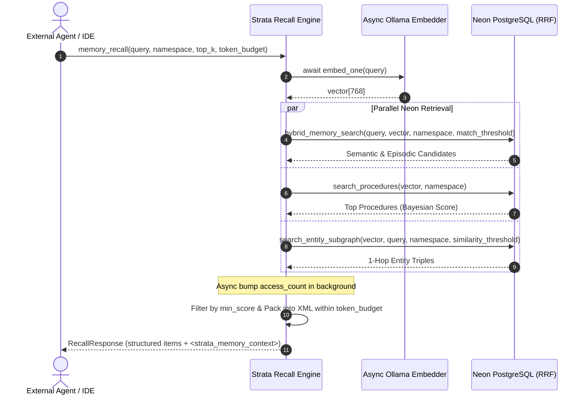
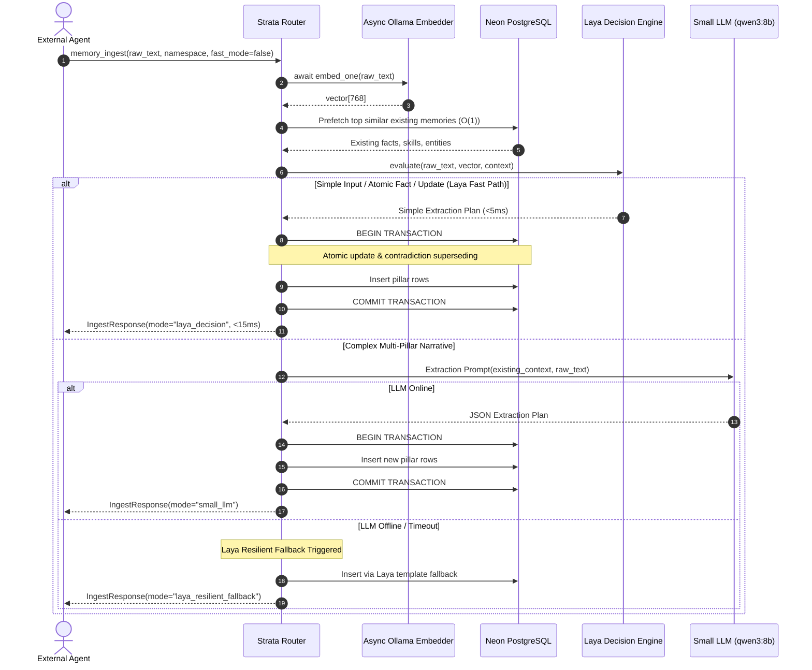
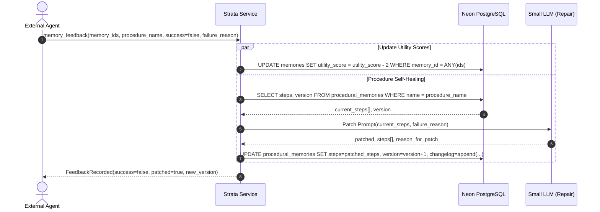

# Strata Architecture, Storage Internals & Scalability Manual

This document is the definitive technical manual for the **Strata Cognitive Memory Engine**, its internal subsystems, data layout in Neon Serverless PostgreSQL, bi-temporal active state management, sub-millisecond retrieval algorithms, Laya Decision Pre-Routing, and long-term scaling mechanisms.

---

## 1. Executive Architectural Overview

Strata is modeled on geological strata: **layered records of history where foundational facts remain anchored beneath recent experiences, adaptable procedures evolve over time, and inter-connected entities form an immutable web of context.**

To eliminate the twin failure modes of classical agent memory systems (high read latency and unbounded context bloat), Strata enforces a strict **Dual-Path Architecture**:

```
                                  +-------------------------------------------------------------+
                                  |                 EXTERNAL AGENT / HARNESS                    |
                                  |     (Jarvis Agent, LangGraph, CrewAI, Claude, Cursor)       |
                                  +------------------------------+------------------------------+
                                                                 |
                                       +-------------------------+-------------------------+
                                       |                                                   |
                             READ PATH (<15ms, Zero-LLM)                         WRITE PATH (Autonomous & Hybrid)
                             `memory_recall`                                     `memory_ingest`, `memory_edit`
                                       |                                                   |
                                       v                                                   v
                        +------------------------------+                    +------------------------------+
                        |     Async Ollama Embedder    |                    |     Async Ollama Embedder    |
                        | (nomic-embed-text: 768 dims) |                    | (nomic-embed-text: 768 dims) |
                        +--------------+---------------+                    +--------------+---------------+
                                       |                                                   |
                                       | Vector Embedding                                  | Prefetches Context O(1)
                                       |                                                   v
                                       |                                    +------------------------------+
                                       |                                    |     Laya Decision Engine     |
                                       |                                    | (Pre-routing, Gating, <5ms)  |
                                       |                                    +--------------+---------------+
                                       |                                                   |
                                       |                                      +------------+------------+
                                       |                                      |                         |
                                       |                               (Simple Input)           (Complex Narrative)
                                       |                                      v                         v
                                       |                               Template Direct           Small Decision LLM
                                       |                               Fast Path (<15ms)         (`qwen3:8b` via API)
                                       |                                      |                         |
                                       v                                      +------------+------------+
                                                                                           |
+------------------------------------------------------------------------------------------v------------------------------+
|                                             NEON SERVERLESS POSTGRESQL 16                                               |
|                               (PgBouncer `-pooler` Transaction Mode + `statement_cache_size=0`)                         |
|                                                                                                                         |
|   +--------------------------------+   +--------------------------------+   +--------------------------------+          |
|   |        `memories` TABLE        |   |  `procedural_memories` TABLE   |   |     `entity_nodes` & `edges`   |          |
|   | • Semantic: Bi-temporal Facts  |   | • Mutable Versioned Runbooks   |   | • Bi-temporal Property Graph   |          |
|   | • Episodic: Execution Traces   |   | • Bayesian Skill Ranking       |   | • 1-Hop Subgraph Traversal     |          |
|   | • HNSW (m=16, ef=64) + GIN FTS |   | • Auto-Patched on Failure      |   | • Conflicting Edge Expiration  |          |
|   +--------------------------------+   +--------------------------------+   +--------------------------------+          |
|                                                    ^                                                                    |
|                                                    |                                                                    |
|                                  `hybrid_memory_search()` SQL Function                                                  |
|                               (Reciprocal Rank Fusion + Utility Score Boost)                                            |
+----------------------------------------------------+--------------------------------------------------------------------+
                                                     |
                                                     v
                                      +------------------------------+
                                      |    Deterministic XML Pack    |
                                      | (Tuned to token_budget/scores|
                                      +--------------+---------------+
                                                     |
                                                     v
                                        Clean `<strata_memory_context>`
```

---

## 2. The 4 Cognitive Memory Pillars

### 2.1 The Semantic Pillar (`type = 'semantic'`)
* **Purpose:** Stores atomic facts, configurations, domain truths, and user preferences.
* **Bi-Temporal Validity:** Every record has `valid_from TIMESTAMPTZ` and `valid_until TIMESTAMPTZ` (where `valid_until IS NULL` indicates the fact is active).
* **Contradiction Superseding:** When a new fact is learned that contradicts an existing fact (either explicitly targeted or automatically detected via cosine similarity `> contradiction_threshold` [default: 0.94] in the same namespace), Strata atomically sets:
  ```sql
  UPDATE memories 
  SET valid_until = NOW(), superseded_by = $new_memory_id 
  WHERE memory_id = $old_memory_id;
  ```
  This preserves historical lineage without polluting future recall queries.

### 2.2 The Episodic Pillar (`type = 'episodic'`)
* **Purpose:** Immutable append-only log of agent execution traces, situations encountered, tools invoked, and final outcomes.
* **Payload Structure (`JSONB`):**
  ```json
  {
    "situation": "Context or problem triggering the run",
    "action_taken": "Tools and steps executed by the agent",
    "outcome": "Observed result or error trace",
    "success": true
  }
  ```
* **Utility Scoring Loop:** When downstream tasks succeed or fail, `memory_feedback` adjusts the `utility_score` of memories used (`+1` for success, `-2` for failure). The RRF ranking engine uses this score to boost proven memories and demote misleading memories.

### 2.3 The Procedural Pillar (`procedural_memories` Table)
* **Purpose:** Reusable, versioned workflows, skills, runbooks, and troubleshooting procedures.
* **Mutable Schema:**
  - `name`: Unique identifier per namespace (`UNIQUE(namespace, name)`).
  - `version`: Integer automatically incremented upon every modification.
  - `steps`: `JSONB` list of clear, executable instructions.
  - `changelog`: `JSONB` array of past modifications with timestamps and reasons.
  - `success_count` & `fail_count`: Track real-world execution reliability.
* **Bayesian Composite Ranking Formula:**
  $$\text{Score} = 0.75 \times (1 - \text{CosineDistance}) + 0.25 \times \left(\frac{\text{success\_count} + 1}{\text{success\_count} + \text{fail\_count} + 2}\right)$$
  - Employs **Laplace smoothing (add-1 smoothing)**: An untested skill starts with an objective baseline of $1 / 2 = 0.50$ (50% probability).
* **Self-Healing Runbooks:** If an agent executes a procedure and reports failure with an error trace via `memory_feedback`, Strata's Small LLM analyzes the error, patches the `steps[]`, increments `version`, and logs the repair reason in `changelog`.

### 2.4 The Entity Graph Pillar (`entity_nodes` & `entity_edges`)
* **Purpose:** Bi-temporal property graph connecting entities (people, services, repositories, servers, concepts).
* **Triples:** `(Source Node) -[Relation Type]-> (Target Node)` with `fact_summary` and JSON properties.
* **Conflicting Relation Expiration:** When an entity changes states (e.g. `Velora` changes its `RUNS_ON` relation from `AWS` to `GCP`), setting `invalidate_conflicting_relations = true` marks prior edges with the same `(namespace, source, relation)` as `valid_until = NOW()`.
* **1-Hop Traversal:** During recall, seed nodes matching the query are joined across active edges to retrieve connected triples.

---

## 3. Subsystem Breakdown

### 3.1 Client Ingress Adapters
* **FastMCP Server (`src/strata/mcp_server.py`):**
  - Exposes all 6 tools to Claude Desktop, Cursor, Zed, and Windsurf via FastMCP.
  - Supports `--transport stdio` (with all logs redirected to `sys.stderr` to keep stdout pure for JSON-RPC stream integrity) and `--transport sse` for distributed setups.
* **FastAPI Server (`src/strata/rest_api.py`):**
  - Exposes REST endpoints (`/v1/memory/*`) with async lifespan management ensuring clean database connection pooling.
  - Generates OpenAPI Swagger UI at `/docs`.
* **Service Controller (`src/strata/service.py`):**
  - Unified business logic hub shared by both MCP and REST entrypoints.

### 3.2 Async Embedding Engine (`src/strata/embedder.py`)
* **Client:** `AsyncOpenAI` connecting to Ollama or any OpenAI-compatible embeddings endpoint.
* **Model:** `nomic-embed-text` generating dense **768-dimensional** vector embeddings.
* **Non-Blocking:** Fully asynchronous (`await embedder.embed_one()`), preventing event loop blockages during high concurrency.
* **Safe Serialization:** Formats vector floats into text literals (`[0.0123456,...]`) passed to Neon via `$1::vector(768)` to avoid driver C-extension decoding issues.

### 3.3 Neon Database Layer (`src/strata/db.py`)
* **PgBouncer `-pooler` Compatibility:** Neon pooled connections operate in transaction mode. Strata explicitly passes `statement_cache_size=0` to prevent prepared statement conflicts.
* **Dual-Connection Architecture:**
  - `DATABASE_URL`: Pooled connection with SSL for runtime queries (`min_size=1, max_size=10`).
  - `DIRECT_DATABASE_URL`: Direct unpooled connection used exclusively for DDL migrations (`sql/001_init_schema.sql`).
* **Scale-to-Zero Handling:** Neon serverless compute suspend/resume cycles are protected by connection retries and `max_inactive_connection_lifetime=300.0`.

### 3.4 Laya Decision Pre-Routing Engine (`src/strata/laya/`)
* **Role:** Sub-5ms pre-routing and classification gatekeeper on the write path.
* **Heuristics & Signal Analysis:**
  - Detects pillar signals (Episodic event words, Procedural step keywords, Entity relationship verbs like `USES`/`RUNS_ON`, and Semantic preferences).
  - Evaluates sentence complexity and conjunction density.
  - Inspects pre-fetched context for direct contradictions and update indicators.
* **Zero-LLM Fast Path:** If input is a straightforward atomic statement or update, generates a structured `MemoryExtractionPlan` directly, bypassing the generative LLM entirely (<15ms latency, 0 tokens).
* **Escalation Gate:** Escalates multi-pillar narratives, complex workflow procedures, and ambiguous multi-entity statements to the Small LLM.

### 3.5 Memory-Side Small LLM Router (`src/strata/llm_processor/router.py`)
* **Model:** `qwen3:8b` (via Ollama or any OpenAI-compatible endpoint).
* **Extraction Workflow:**
  1. Computes local query vector asynchronously.
  2. Prefetches top active memories from Neon using configurable limits (`prefetch_semantic_limit`, etc.).
  3. Formulates structured prompt with `response_format={"type": "json_object"}`.
  4. Decomposes raw text into structured operations across the 4 pillars.
* **Graceful Degradation:** If the Small LLM times out or is offline, Strata engages Laya template extraction or deterministic fallback into `memories`, ensuring the calling agent never crashes.

### 3.6 Deterministic Recall & Packing Engine (`src/strata/recall.py`)
* **Concurrent Querying:** Dispatches `hybrid_memory_search` (Semantic + Episodic), `search_procedures` (Procedural), and `search_entity_subgraph` (Entity) concurrently via `asyncio.gather`.
* **Dynamic Score Filtering:** Filters recalled candidates against `min_score`, `match_threshold`, and `similarity_threshold`.
* **Asynchronous Access Counter:** Launches an asynchronous background task to increment `access_count` on all returned memory UUIDs without adding query latency.
* **Token Budget Packing:** Calculates token count approximation (`chars // 4`) and packs items section by section. If budget is exceeded, it cleanly closes all XML tags, preserving XML syntax.

---

## 4. Bi-Temporal Data Model & Active State Management

In Strata, historical knowledge is never lost or destructively overwritten. Instead, it is superseded using bi-temporal timestamps.

### 4.1 Database Schema Constraints (`sql/001_init_schema.sql`)

```sql
-- Core Fact & Event Store
CREATE TABLE IF NOT EXISTS memories (
    memory_id      UUID PRIMARY KEY DEFAULT gen_random_uuid(),
    namespace      TEXT NOT NULL DEFAULT 'default',
    type           TEXT NOT NULL CHECK (type IN ('semantic', 'episodic')),
    summary        TEXT NOT NULL,
    payload        JSONB NOT NULL DEFAULT '{}'::jsonb,
    tags           TEXT[] NOT NULL DEFAULT '{}',
    embedding      VECTOR(768) NOT NULL,
    confidence     FLOAT NOT NULL DEFAULT 1.0,
    utility_score  INT NOT NULL DEFAULT 0,
    access_count   INT NOT NULL DEFAULT 0,
    source_id      TEXT,
    superseded_by  UUID REFERENCES memories(memory_id) ON DELETE SET NULL,
    valid_from     TIMESTAMPTZ NOT NULL DEFAULT NOW(),
    valid_until    TIMESTAMPTZ DEFAULT NULL, -- NULL means currently ACTIVE
    created_at     TIMESTAMPTZ NOT NULL DEFAULT NOW()
);

-- Versioned Skill & Workflow Store
CREATE TABLE IF NOT EXISTS procedural_memories (
    procedure_id      UUID PRIMARY KEY DEFAULT gen_random_uuid(),
    namespace         TEXT NOT NULL DEFAULT 'default',
    name              TEXT NOT NULL,
    description       TEXT NOT NULL,
    trigger_condition TEXT NOT NULL,
    trigger_embedding VECTOR(768) NOT NULL,
    steps             JSONB NOT NULL DEFAULT '[]'::jsonb,
    prerequisites     JSONB NOT NULL DEFAULT '{}'::jsonb,
    version           INT NOT NULL DEFAULT 1,
    changelog         JSONB NOT NULL DEFAULT '[]'::jsonb,
    success_count     INT NOT NULL DEFAULT 0,
    fail_count        INT NOT NULL DEFAULT 0,
    is_active         BOOLEAN NOT NULL DEFAULT TRUE,
    updated_at        TIMESTAMPTZ NOT NULL DEFAULT NOW(),
    UNIQUE(namespace, name)
);

-- Entity Nodes (Knowledge Graph)
CREATE TABLE IF NOT EXISTS entity_nodes (
    entity_id   UUID PRIMARY KEY DEFAULT gen_random_uuid(),
    namespace   TEXT NOT NULL DEFAULT 'default',
    name        TEXT NOT NULL,
    entity_type TEXT NOT NULL,
    summary     TEXT NOT NULL,
    attributes  JSONB NOT NULL DEFAULT '{}'::jsonb,
    embedding   VECTOR(768) NOT NULL,
    updated_at  TIMESTAMPTZ NOT NULL DEFAULT NOW(),
    UNIQUE(namespace, name, entity_type)
);

-- Entity Edges (Bi-temporal Relationships)
CREATE TABLE IF NOT EXISTS entity_edges (
    edge_id          UUID PRIMARY KEY DEFAULT gen_random_uuid(),
    namespace        TEXT NOT NULL DEFAULT 'default',
    source_entity_id UUID NOT NULL REFERENCES entity_nodes(entity_id) ON DELETE CASCADE,
    relation_type    TEXT NOT NULL,
    target_entity_id UUID NOT NULL REFERENCES entity_nodes(entity_id) ON DELETE CASCADE,
    fact_summary     TEXT NOT NULL,
    properties       JSONB NOT NULL DEFAULT '{}'::jsonb,
    valid_from       TIMESTAMPTZ NOT NULL DEFAULT NOW(),
    valid_until      TIMESTAMPTZ DEFAULT NULL
);
```

### 4.2 The Validity Rules

| Memory State | Database Condition | Meaning | Query Behavior |
|---|---|---|---|
| 🟢 **ACTIVE** | `(valid_until IS NULL OR valid_until > NOW())` | Currently true and unexpired. | **Included** in all active recall operations. |
| 🔴 **SUPERSEDED** | `valid_until IS NOT NULL AND superseded_by IS NOT NULL` | Replaced by newer fact. Preserved for audit. | **Excluded** from all active recall operations. |
| ⏳ **EXPIRED (TTL)** | `valid_until IS NOT NULL AND valid_until <= NOW()` | Temporal fact reached TTL. Candidate for distillation. | **Excluded** from recall; pruned during compaction. |

### 4.3 Composite & B-Tree Indexing for Zero-Cost Filtering

To ensure active memory lookups, graph traversals, and pruning execute in sub-millisecond time even as millions of superseded records accumulate:

```sql
-- 1. Active Semantic & Episodic Recall (Composite Index covering namespace, type, and temporal range)
CREATE INDEX IF NOT EXISTS idx_memories_ns_type_valid_until
    ON memories (namespace, type, valid_until);

-- 2. Episodic Pruning & Compaction Order
CREATE INDEX IF NOT EXISTS idx_memories_ns_type_created_at
    ON memories (namespace, type, created_at ASC);

-- 3. Bi-temporal Lineage & Child Audit Traversal
CREATE INDEX IF NOT EXISTS idx_memories_superseded_by
    ON memories (superseded_by) WHERE superseded_by IS NOT NULL;

-- 4. Entity Graph 1-Hop Traversal (Bidirectional & Conflict Invalidation)
CREATE INDEX IF NOT EXISTS idx_entity_edges_src_rel
    ON entity_edges (namespace, source_entity_id, relation_type, valid_until);

CREATE INDEX IF NOT EXISTS idx_entity_edges_tgt
    ON entity_edges (namespace, target_entity_id, valid_until);

-- 5. Active Node & Procedure Filters
CREATE INDEX IF NOT EXISTS idx_entity_nodes_ns_active
    ON entity_nodes (namespace) WHERE is_active = TRUE;

CREATE INDEX IF NOT EXISTS idx_procedural_ns_active
    ON procedural_memories (namespace) WHERE is_active = TRUE;
```

---

## 5. Long-Term Scalability & Edge-Case Architecture

When an agentic system runs in production over 6–12+ months, it encounters two fundamental scalability bottlenecks:
1. **Write Path Context Collapse:** Passing all existing memories into an LLM causes prompt overflow ($O(N)$ growth).
2. **Read Path Latency Degradation:** Sequential vector scans or calling LLMs on read requests degrades latency into seconds.

Strata resolves both bottlenecks through targeted architectural mechanisms:

### Mechanism 1: Constant-Context Pre-Fetching ($O(1)$) & Laya Fast-Path
```
[New Statement Arrives]
          │
          ▼
Compute Embedding via Ollama Async (<5ms)
          │
          ▼
Neon HNSW Query: Pre-fetch Top-N Semantically Nearest Active Facts (O(1))
          │
          ▼
Laya Decision Engine (<2ms Signal & Complexity Check)
          │
    ┌─────┴──────────────────────────────────────────────────────┐
    ▼                                                            ▼
[Simple Atomic Input / Update]                      [Complex Multi-Pillar Narrative]
Direct Zero-LLM Fast Path (<15ms, 0 tokens)         Small Decision LLM Prompt (~250 tokens)
    │                                                            │
    └─────────────────────────────┬──────────────────────────────┘
                                  ▼
                Decomposes, Supersedes Contradictions,
                     and Stores into Neon Postgres
```

Whether Neon holds **50 memories** or **5,000,000 memories**, the context passed forward is strictly bounded to ~250–400 tokens ($O(1)$). Simple statements bypass the LLM completely via Laya.

### Mechanism 2: Sub-Millisecond HNSW Indexing ($O(\log N)$)
```sql
CREATE INDEX idx_memories_embedding_hnsw
ON memories USING hnsw (embedding vector_cosine_ops)
WITH (m = 16, ef_construction = 64);
```
At 1,000,000 records, finding the nearest neighbors takes **~2ms to 4ms**.

### Mechanism 3: Relational Reciprocal Rank Fusion (RRF)
Fuses vector HNSW rank and BM25 lexical rank inside the Postgres database engine:
$$\text{Score} = \frac{1}{60 + \text{rank}_{\text{vec}}} + \frac{1}{60 + \text{rank}_{\text{bm25}}} + (\text{utility\_boost})$$
- `rank_vector`: Derived from HNSW cosine distance `(m.embedding <=> query_vec)`.
- `rank_bm25`: Derived from `ts_rank_cd(to_tsvector('english', summary), parsed_query)`.
- `utility_boost`: `clamp(utility_score, -5, +20) * 0.001` (proven memories rank higher).

### Mechanism 4: Bayesian Procedural Reliability
Procedural runbooks are scored based on semantic intent similarity combined with Laplace-smoothed historical success rates:
$$\text{Score} = 0.75 \times (1 - \text{CosineDist}) + 0.25 \times \left(\frac{\text{success} + 1}{\text{total} + 2}\right)$$

### Mechanism 5: Strict Caller Token Budget Packing
The recall engine packs items section-by-section (`<semantic_facts>`, `<entity_graph>`, `<procedural_skills>`, `<episodic_history>`). If the character budget (`token_budget * 4`) is exceeded, appending stops immediately and closing XML tags are written cleanly.

---

## 6. End-to-End Sequence Flows

### Flow 1: Deterministic Hybrid Recall (`memory_recall`)


---

### Flow 2: Intelligent Ingestion & Contradiction Superseding (`memory_ingest`)


---

### Flow 3: Reinforcement Learning & Runbook Self-Healing (`memory_feedback`)


---

## 7. Fault Tolerance & Graceful Degradation Matrix

| Scenario / Failure | Impact | Strata Handling Mechanism |
|---|---|---|
| **Ollama / Local LLM Offline** | Write Path `memory_ingest` | Catches connection error and engages Laya template extraction or zero-LLM deterministic insert (`mode: "deterministic_fallback"`). Calling agent never crashes. |
| **Neon Compute Sleeping (Scale-to-Zero)** | Cold-start query | Neon wakes compute automatically within 500ms–1.5s. `asyncpg` pool handles connection retry with `command_timeout=30.0` and `max_inactive_connection_lifetime=300.0`. |
| **Empty or Whitespace Search Query** | Full-Text Search in `hybrid_memory_search` | SQL function verifies `websearch_to_tsquery` parsing safely; if empty or stop-words, bypasses BM25 and falls back seamlessly to 100% vector cosine search. |
| **High Concurrency on Neon** | Connection Limits | PgBouncer `-pooler` endpoint multiplexes hundreds of concurrent client connections over 10 direct server connections with `statement_cache_size=0`. |
| **Very Small Token Budget** | XML Context Packing | Token budgeter truncates candidates item by item and appends closing XML tags, guaranteeing valid XML syntax. |
