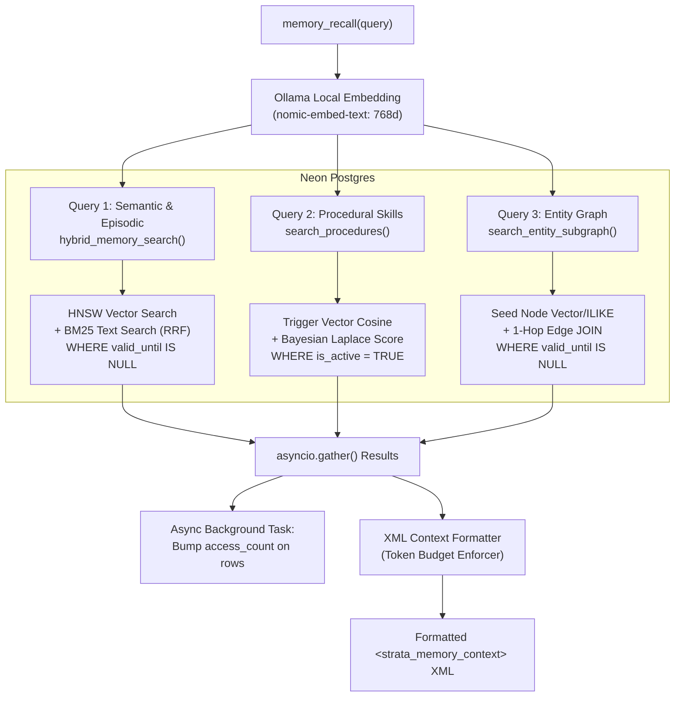

# Strata Deep Dive: Active State Management, Data Storage & Recall Architecture

This guide provides an in-depth technical explanation of two core mechanisms in Strata:
1. **How active vs. superseded states are managed** across memories.
2. **Where data across the 4 pillars is stored** in Neon PostgreSQL and **how `memory_recall` retrieves and formats it**.

---

## Part 1: How & Where is the "Active" vs. "Superseded" State Managed?

Strata uses a **bi-temporal data model** to maintain historical accuracy without contaminating current recall queries with outdated or contradictory facts.

### 1. Database Schema (`sql/001_init_schema.sql`)

In the `memories` table, every record has three validity columns:

```sql
CREATE TABLE IF NOT EXISTS memories (
    memory_id      UUID PRIMARY KEY DEFAULT gen_random_uuid(),
    namespace      TEXT NOT NULL DEFAULT 'default',
    type           TEXT NOT NULL CHECK (type IN ('semantic', 'episodic')),
    summary        TEXT NOT NULL,
    payload        JSONB NOT NULL DEFAULT '{}'::jsonb,
    tags           TEXT[] NOT NULL DEFAULT '{}',
    embedding      VECTOR(768) NOT NULL,
    confidence     FLOAT NOT NULL DEFAULT 1.0,
    utility_score  INT NOT NULL DEFAULT 0,
    access_count   INT NOT NULL DEFAULT 0,
    source_id      TEXT,
    superseded_by  UUID REFERENCES memories(memory_id) ON DELETE SET NULL,
    valid_from     TIMESTAMPTZ NOT NULL DEFAULT NOW(),
    valid_until    TIMESTAMPTZ DEFAULT NULL, -- NULL means currently ACTIVE
    created_at     TIMESTAMPTZ NOT NULL DEFAULT NOW()
);
```

### 2. The Validity Rules

| Memory State | Database Condition | Meaning | Query Behavior |
|---|---|---|---|
| 🟢 **ACTIVE** | `valid_until IS NULL` | Currently true and active. | **Included** in all recall operations. |
| 🔴 **SUPERSEDED** | `valid_until IS NOT NULL` | Replaced by newer fact. Preserved for audit. | **Excluded** from all recall operations. |

To make queries for active memories run in constant time, Neon uses a **partial index**:

```sql
CREATE INDEX IF NOT EXISTS idx_memories_ns_type_active
    ON memories (namespace, type) 
    WHERE valid_until IS NULL;
```

This index ignores superseded memories entirely, so search operations never suffer latency degradation as old memories accumulate.

---

### 3. Code Implementation (`src/strata/pillars/semantic.py`)

In `add_or_supersede_semantic()`, state transitions occur atomically:

```python
# 1. Insert the new fact (valid_from = NOW(), valid_until = NULL -> ACTIVE)
insert_sql = """
    INSERT INTO memories (
        namespace, type, summary, payload, tags, embedding,
        confidence, utility_score, access_count, source_id, valid_from
    )
    VALUES ($1, 'semantic', $2, $3, $4, $5::vector(768), $6, 0, 0, $7, NOW())
    RETURNING memory_id;
"""
new_row = await c.fetchrow(insert_sql, ...)
new_id = str(new_row["memory_id"])

# 2. If this fact supersedes an older fact, inactivate the old record
if supersede_memory_id:
    update_sql = """
        UPDATE memories
        SET valid_until = NOW(),       -- Marks previous fact as SUPERSEDED
            superseded_by = $1         -- Creates pointer to the replacement
        WHERE memory_id = $2
          AND namespace = $3
          AND valid_until IS NULL;
    """
    await c.execute(update_sql, UUID(new_id), UUID(supersede_memory_id), namespace)
```

---

### 4. Real-World Walkthrough (Case 2 in Action)

1. **Initial State (Case 1):**
   Agent ingests: *"Strata decision LLM is configured to run on cloud OpenAI gpt-4o."*
   - Row inserted: `memory_id = 2f36e37c`, `valid_until = NULL` (ACTIVE).
2. **Contradiction Arrives (Case 2):**
   Agent ingests: *"Update: We decided to deploy Strata's decision LLM locally using Ollama qwen3:8b instead of cloud OpenAI."*
3. **Small LLM Decision:**
   `qwen3:8b` inspects existing memories, identifies the contradiction, and outputs:
   ```json
   {
     "action": "SUPERSEDE",
     "supersede_memory_id": "2f36e37c-11c6-41ca-bee5-e3e27f698e74",
     "summary": "Strata decision LLM is configured to run locally on Ollama qwen3:8b"
   }
   ```
4. **Atomic DB Update:**
   - Old row `2f36e37c` gets `valid_until = '2026-11-14 11:34:00'` and `superseded_by = 90b40472`.
   - New row `90b40472` gets `valid_until = NULL`.
5. **Result in Neon Database:**
   ```
   [2f36e37c] [🔴 SUPERSEDED (by 90b40472)] Strata decision LLM is cloud OpenAI
   [90b40472] [🟢 ACTIVE]                  Strata decision LLM is Ollama qwen3:8b
   ```

---

## Part 2: Where Data is Stored & How Recall Retrieves It

### 1. Storage Location by Pillar in Neon PostgreSQL

```
+-----------------------------------------------------------------------------------------------+
|                                 NEON SERVERLESS POSTGRESQL 16                                 |
+-----------------------------------------------------------------------------------------------+
| 1. `memories` TABLE                                                                           |
|    • Semantic Facts: type='semantic', summary, tags, embedding, valid_until                   |
|    • Episodic History: type='episodic', payload (situation, action_taken, outcome, success)  |
+-----------------------------------------------------------------------------------------------+
| 2. `procedural_memories` TABLE                                                                |
|    • Workflows & Skills: name, trigger_condition, trigger_embedding, steps JSONB,             |
|                          changelog JSONB, version, success_count, fail_count, is_active       |
+-----------------------------------------------------------------------------------------------+
| 3. `entity_nodes` TABLE                                                                       |
|    • Graph Nodes: name, entity_type, summary, attributes JSONB, embedding                     |
+-----------------------------------------------------------------------------------------------+
| 4. `entity_edges` TABLE                                                                       |
|    • Graph Edges: source_entity_id, relation_type, target_entity_id, fact_summary, valid_until|
+-----------------------------------------------------------------------------------------------+
```

---

### 2. How `memory_recall` Retrieves & Assembles Memories

When an agent invokes `memory_recall(query, namespace, pillars, top_k, token_budget)`, Strata executes the following deterministic zero-LLM pipeline:



---

### 3. Detailed Retrieval Algorithms

#### A. Semantic & Episodic Retrieval: Reciprocal Rank Fusion (RRF)
Implemented in `sql/001_init_schema.sql` via `hybrid_memory_search()`:
- **Vector Cosine Rank:**
  `ROW_NUMBER() OVER (ORDER BY (m.embedding <=> query_embedding) ASC) AS rank_vec`
- **Lexical BM25 Rank:**
  `ROW_NUMBER() OVER (ORDER BY ts_rank_cd(to_tsvector('english', m.summary), parsed_query) DESC) AS rank_txt`
- **Fused Formula:**
  $$\text{Score} = \frac{1}{60 + \text{rank}_{\text{vec}}} + \frac{1}{60 + \text{rank}_{\text{txt}}} + (\text{utility\_boost})$$
- **Filtering:**
  `WHERE m.valid_until IS NULL` ensures **superseded facts are never evaluated or returned**.

#### B. Procedural Retrieval: Bayesian Skill Ranking
Implemented in `src/strata/pillars/procedural.py` via `search_procedures()`:
- Calculates similarity between user intent and skill trigger: `(1.0 - (trigger_embedding <=> query_vec))`.
- Integrates historical reliability using Laplace smoothing:
  $$\text{Score} = 0.75 \times (1 - \text{CosineDist}) + 0.25 \times \left(\frac{\text{success\_count} + 1}{\text{success\_count} + \text{fail\_count} + 2}\right)$$
- An untested procedure ($0$ success, $0$ fail) starts at an objective baseline of $1 / 2 = 0.50$ (50%).

#### C. Entity Graph Retrieval: 1-Hop Subgraph Traversal
Implemented in `src/strata/pillars/entity_graph.py` via `search_entity_subgraph()`:
- Finds top seed nodes via vector cosine similarity or `ILIKE` name matching.
- Performs a 1-hop SQL `JOIN` across active edges (`valid_until IS NULL`):
  ```sql
  SELECT e.edge_id, src.name AS source_name, e.relation_type, tgt.name AS target_name, e.fact_summary
  FROM entity_edges e
  JOIN entity_nodes src ON e.source_entity_id = src.entity_id
  JOIN entity_nodes tgt ON e.target_entity_id = tgt.entity_id
  WHERE e.namespace = $1 AND e.valid_until IS NULL
    AND (e.source_entity_id IN (SELECT entity_id FROM seed_nodes)
         OR e.target_entity_id IN (SELECT entity_id FROM seed_nodes));
  ```

#### D. Token Budget Enforcing & XML Packing
Implemented in `src/strata/recall.py` via `build_xml_context()`:
- Approximates token count as `len(text) // 4`.
- Inserts items across `<semantic_facts>`, `<entity_graph>`, `<procedural_skills>`, and `<episodic_history>`.
- If the token budget is reached, it stops appending items and immediately writes all closing XML tags:
  ```xml
  <strata_memory_context namespace="production">
    <semantic_facts>
      - [mem_id=cbc65955] Dheeban is the lead system architect for Strata
      - [mem_id=90b40472] Strata decision LLM is configured to run locally on Ollama qwen3:8b
      - [mem_id=bc4178e5] Core backend persistence will run on Neon Serverless PostgreSQL in ap-southeast-1
    </semantic_facts>
    <entity_graph>
      - (Velora [project]) -[USES_DATABASE]-> (Neon [infrastructure]): Velora uses Neon PostgreSQL for persistence
    </entity_graph>
  </strata_memory_context>
  ```
- This guarantees the calling agent's prompt context is never polluted with broken XML or unclosed tags.
